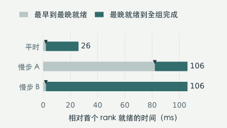

假设两台服务器各有 8 张 GPU，16 个训练进程（rank）在反向传播中对同一个梯度桶做 AllReduce。平时从第一张卡准备好这桶梯度，到最后一张卡拿到归约结果，要 26 ms。今天，同一桶用了 106 ms。多出来的 80 ms 花在哪儿？

如果只能多采一项数据，我会先取**最后一个 rank 的梯度就绪时刻**。假如它晚了 80 ms，值得先翻的是这张卡前面的计算和取数记录。如果它准时就绪，取证范围就变了。下面用两组示意时间线走一遍这个判断，数字仅用于说明推理过程。

<!-- more -->

## 同样的 106 ms，两条不同的时间线

把同一通信组、同一序号、同一大小的 AllReduce 配对。每一轮都以最早就绪的 rank 为 0 ms。“就绪”指本 rank 的梯度桶在 GPU 上已准备好，可以交给通信流；“全组完成”取所有 rank 中最晚的设备侧完成时刻。实际采集时，可以用梯度桶的就绪标记配合 GPU trace，并先校准跨主机时间线。单看 Python 调用返回的时刻，会把异步提交和 GPU 执行混在一起。[Nsight Systems 跟踪指南][nsys] · [PyTorch Flight Recorder][torch]

**慢步 A** 中，最后一个 rank 到 82 ms 才备好梯度。此后全组又用 24 ms 完成，和平时相同。值得展开的是晚到 rank 的前一段轨迹：相同算子是否拿到了更长的样本？输入批次什么时候准备好？其他 rank 可以早早进入 NCCL 内核，等它们所依赖的数据。只看早到者的长条，很容易把 80 ms 都记到网络头上。

**慢步 B** 中，所有 rank 在 2 ms 内都准备好了，全组却又过了 104 ms 才完成。下一步可以逐项核对通信流何时获得 GPU 执行机会、数据走了哪张网卡、哪一跳出现排队。图中深色区间也包括调度和协议开销。各 rank 还能在最后一份梯度就绪前传送部分数据，所以单凭这两个时间点算不出线上的传输耗时。

最后回到训练本身。沿时间线找到**第一个必须消费归约结果的算子**。如果它仍能按时启动，这次 AllReduce 的延长被其他计算覆盖了。如果它也推迟了 80 ms，这个梯度桶才值得作为慢步的重点追踪对象。

## 把这桶梯度放到实际路径上

先记下这次通信的 rank、节点、GPU 和网卡端口。节点内的 `nvidia-smi topo -m` 能显示 GPU 与 GPU、GPU 与网卡的拓扑关系。短时复现时，可以打开 `NCCL_DEBUG=INFO`，用 `NCCL_DEBUG_SUBSYS=INIT,GRAPH,NET` 看初始化、拓扑和网络选择，并用 `NCCL_DEBUG_FILE=/tmp/nccl.%h.%p.log` 将不同节点和进程的日志分开。例如，日志里出现一张用于建立初始连接的以太网接口，还得继续看承载梯度的通道用了哪个网络后端。[NVIDIA 拓扑命令手册][smi] · [NCCL 日志选项][env]

| 网络段 | 可能遇到的连接 | 与当前慢步有关的证据 |
| --- | --- | --- |
| GPU 互联域内 | NVLink / NVSwitch | 并行组实际落在哪个互联域？单域内、同消息大小的测试能否复现？域边界随平台而变，可以跨越机箱。 |
| 跨节点后端 | InfiniBand（IB） | 找到 HCA 端口和经过的交换机，核对路径、协商速率与宽度，再看出方向的发送等待和错误增量。 |
| 跨节点后端 | RoCEv2 | 找到承载 RDMA 的以太网优先级和实际出口，对齐队列水位、拥塞标记、端侧反馈与暂停时长。 |
| 跨节点后端 | TCP/IP 以太网 | 若本次通信使用 Socket 传输，查对应接口、TCP 重传、队列和主机 CPU。TCP 也可能单独承担存储或管理流量。 |
| 前端与广域 | 算力专线 / 数据中心互联（DCI） | 查并行组是否跨中心。逐步同步涉及往返时延（RTT）和抖动；异步检查点还要看它是否在本地与训练争用了出口。 |
| 前端与广域 | 多云 / 边缘接入 | 追踪样本、模型或请求的到达时间。若远端输入已缓存，查看这批数据实际何时读入，比查看跨云平均时延更有解释力。 |

一次操作可以同时经过前两段。两台服务器先各自在域内交换梯度，再经后端网完成跨节点通信，任何一段变慢，都可能出现在同一条 AllReduce 记录里。还要记下实际算法和卸载配置。例如 NCCL 2.27 在支持的 NVLink SHARP 与 IB SHARP 组合上扩展了 AllGather 和 ReduceScatter 卸载。对比两组结果前，应核实本次操作有没有走这条路径。[NVIDIA 对 NCCL 2.27 卸载路径的说明][sharp]

## 慢步 B 应该看哪一个端口？

沿用上面的例子。假设单机运行正常，两台服务器一起跑时偶发慢步，且慢步集中在另一个作业写检查点的时段。存储流量走 TCP，训练走 RoCEv2。为了判断它们是否互相影响，先把两条流的物理出口画出来：如果它们经由不同网卡、不同交换路径，还要继续找共享的 PCIe、主机内存或存储资源。仅凭时间重合，无法把拥塞归给训练网。

如果两条流确实经过同一个上联口，我会沿着这个方向取三份记录：

1. **交换机出口。** 取慢步前后同一采样窗的各队列水位峰值、ECN 标记包数增量和发送包数增量。两个队列即使共享一个物理端口，划到的优先级也可能不同。一分钟平均吞吐很平，仍可能掩盖短时排队。
2. **接收、发送两端的网卡。** 在使用 DCQCN 的部署里，接收端可以针对带 ECN 拥塞标记的流量发回 CNP，发送端据此调节速率。对照接收端发送的 CNP 和发送端收到的 CNP，再看哪个方向出现吞吐变化。若启用了 PFC，另取同一优先级的收发暂停时长；一次暂停可以影响这条链路上同优先级的其他流。[Cumulus Linux 的 RoCE 模式说明][roce] · [NVIDIA 的 RoCE 端口与队列指标][netq]
3. **错开一次回写再测。** 在受控环境中，固定节点、GPU 映射、梯度桶大小和软件版本。交替重复“训练独占”“同一出口并发回写”两种条件。如果只有并发组反复出现同一出口水位上升、拥塞反馈增加、全组完成变晚，而 rank 就绪时间分布基本不变，就有了把原因缩小到共享出口的依据。若移开回写后仍慢，继续查 GPU 到网卡的本地路径。[站内的 GPUDirect RDMA 与 NUMA 拓扑实测思路][gdr]

**换成 IB，沿用这组对照，只换采集的证据。** 先确认子网管理器（SM）看到的链路和算路结果，再沿实际路径看端口宽度、速率、错误及 `PortXmitWait` 的增量。这个计数表示端口有数据待发、却在相应计数周期内没有发出；信用不足和仲裁等待都可能使它增长。比较时记录设备的计数单位，并结合相邻端口的流量和错误。仅看到某个运行数月的端口累计值很大，还不足以解释今天的 80 ms。[NVIDIA IB 集群验收指南][ibfabric] · [ibdiagnet 对发送等待的定义][ibwait]

## 用训练任务的口径验收 IB 与 RoCEv2

两套后端网都先跑同一套负载。先从生产 trace 抽出常见的集合操作、参与 rank 数和消息大小。梯度同步重就测 AllReduce，参数分片还要覆盖 AllGather、ReduceScatter；专家并行则要加入 All-to-All，以及专家负载不均时的真实流量分布。均匀的合成测试可作为基线，热点要靠回放或实际训练补上。

| 实验 | 固定和改变什么 | 保留什么结果 |
| --- | --- | --- |
| 单域、跨节点、跨机架 | 尽量固定总 rank 数、消息大小和每个 rank 的数据量，记录每次放置造成的拓扑与算法变化 | 各消息大小的耗时、正确性、算法带宽，以及实际使用的端口 |
| 独占、并发、突发回写 | 保持训练配置，分别加入第二个训练作业和可重复的存储回写 | 预热后逐步记录 p50 / p95 / p99 step 时间、样本数及统计窗口；同时保留最慢若干步的 trace 与端口计数 |
| 长稳与恢复 | 覆盖多个检查点周期，并在测试集群安排一次约定的链路切换 | 检测和恢复耗时、任务是否重启、恢复后的吞吐与结果正确性 |

读 `nccl-tests` 时，要分清 `algbw` 和 `busbw`。对 AllReduce，前者是每个 rank 的消息大小除以操作耗时；后者按 rank 数乘上系数 `2 × (n − 1) / n`。这里有 16 个 rank，系数为 1.875。它帮助比较集合通信效率；想知道两台服务器之间那条上联到底过了多少字节，应读取对应端口的字节计数。测试工具打印的平均耗时也无法给出真实训练的 p99，后者要从逐步样本另算。[NVIDIA nccl-tests 指标定义][perf]

如果要据此选型，我会让两套候选网络都回答同一个验收问题：**在约定的并行组和回写并发下，多少个训练 step 超过了业务给出的时间预算，最慢的那些步又能解释到哪一跳？** IB 团队需要能查算路、信用和端口状态，RoCEv2 团队需要能串起端到端 QoS、队列和拥塞反馈。对这 16 张卡，真正影响选择的是训练能获得的尾延迟、异常后的恢复时间，以及当班的人手里有没有足够的证据解释下一次掉速。

[nsys]: https://docs.nvidia.com/nsight-systems/UserGuide/
[torch]: https://docs.pytorch.org/tutorials/prototype/flight_recorder_tutorial.html
[smi]: https://docs.nvidia.com/deploy/nvidia-smi/
[env]: https://docs.nvidia.com/deeplearning/nccl/user-guide/docs/env.html#nccl-debug-subsys
[sharp]: https://developer.nvidia.com/blog/enabling-fast-inference-and-resilient-training-with-nccl-2-27/
[roce]: https://docs.nvidia.com/networking-ethernet-software/cumulus-linux-50/Layer-1-and-Switch-Ports/Quality-of-Service/RDMA-over-Converged-Ethernet-RoCE/
[netq]: https://docs.nvidia.com/networking-ethernet-software/cumulus-netq-51/Manage-Events-and-Notifications/TCA-Events-Reference/
[ibfabric]: https://docs.nvidia.com/networking/display/infiniband-cluster-bring-up-procedure-v1-0.0.pdf
[ibwait]: https://docs.nvidia.com/ibdiagnet-infiniband-fabric-diagnostic-tool-user-manual-v2-13-0.pdf
[gdr]: /2026/11/20/2026-11-20-gpudirect-rdma-numa-topology/
[perf]: https://github.com/NVIDIA/nccl-tests/blob/master/doc/PERFORMANCE.md
